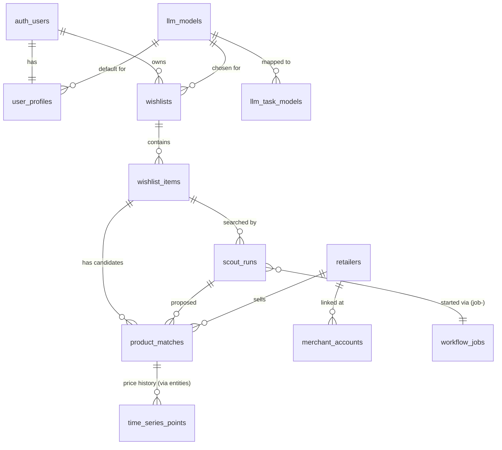

# Database: AI Shopping Wishlist ("Scout")

## Overview
The wishlist domain lives in two migrations on top of the template's generic schema:

| File | Contents |
|------|----------|
| `supabase/migrations/20261111120000_wishlist_domain.sql` | Tables, guard triggers, RLS, column grants, views, Realtime publication |
| `supabase/migrations/20261111120100_wishlist_rpcs.sql` | Shopper, admin and worker RPCs, plus their EXECUTE grants |
| `supabase/seed.sql` | Launch retailers (KE/US/ZA matrix), empty background-task mappings, `product_price` fact type, rollout settings |

Design decisions: [ADR-0002](adrs/0002-workflow-jobs-outbox.md) (outbox), [ADR-0003](adrs/0003-model-provider-and-registry.md) (model registry), [ADR-0007](adrs/0007-auth-and-trust-boundaries.md) (trust boundaries), [ADR-0008](adrs/0008-domain-tables-with-rls.md) (domain tables + RLS). Spec: [`specs/ai-shopping-wishlist.md`](specs/ai-shopping-wishlist.md).

## Schema Overview



### Tables

| Table | Owner / access | Notes |
|-------|----------------|-------|
| `user_profiles` | user (select/update own) | Created by an `after insert on auth.users` trigger. Guard trigger checks model and retailers per country; `onboarding_completed_at` needs country, currency and ≥1 retailer. |
| `wishlists` | user (CRUD own) | `model_id` must be an enabled platform model (guard trigger). |
| `wishlist_items` | user (CRUD own) | Clients may insert drafts (only after onboarding), edit fields and archive/unarchive. Other status changes happen only in RPCs/worker. |
| `scout_runs` | user read own, admin read all | Written by RPCs only. Snapshots `llm_model_id`, `model_id`, `task_models`, `retailer_codes`, `previous_item_status`. One active (`queued`/`running`) run per item (partial unique index). |
| `product_matches` | user read own | Written by `record_candidate` (worker); decisions only via `decide_match`. `uq_match_per_item (wishlist_item_id, canonical_url)` dedupes. |
| `merchant_accounts` | user (CRUD own) | Metadata only, no secrets. Changes are audit-logged by trigger. |
| `notifications` | user read/delete own, update `read_at` | New matches/price drops (scheduled runs), model fallback, failed runs, stale picks. |
| `llm_models` | users read enabled platform rows; admins manage | Column-level grants hide `secret_ref` (always select explicit columns, or use `available_models`). `is_default` and test columns are written only by `set_default_model()` / the worker. Can't be enabled until `last_test_ok`. Saving a model enqueues a `model_test` job. |
| `llm_task_models` | admin | `null` = use wishlist model. Must point to an enabled platform model. |
| `retailers` | users read enabled; admins manage | `country_domains` market matrix, `cross_border_countries` (Amazon for KE). |
| `shopify_stores` | admin read/update; worker writes | Discovery cache. Admin `seed`/`blocked` status is never overwritten by discovery. |
| `fx_rates` | authenticated read; worker writes | USD-based daily rates. |
| `workflow_jobs` | user read own, admin read all; no client writes | Transactional outbox (ADR-0002). |
| `audit_events` | admin read all; users read events about themselves | Admin-table writes (trigger, admin JWT only), scout runs, decisions, linked accounts, model tests. |
| `app_settings` | admin | `wishlist_scout_enabled`, `scout_beta_allowlist_enabled`, `scout_beta_allowlist`, `scout_daily_cap`. |

The template's generic tables (`entities`, `entity_versions`, `relationships_v2`, `fact_types`, `entity_facts`, `time_series_points`) now have RLS enabled with no client policies (except `fact_types` read), so only the worker and security-definer RPCs touch them. Price history is stored as `time_series_points` against an `entities` row of type `product_match`.

### Views (all `security_invoker = true`)
- `available_models`: safe columns of enabled models for pickers (`model_group` = `platform` | `mine`).
- `fx_latest`: latest rate per currency.
- `admin_usage_summary`, `admin_retailer_usage`, `admin_task_usage`: runs, tokens and failures by model, retailer and background task. Non-admins see only their own runs through RLS.

## State machines
```
wishlist_items.status: draft → scouting → candidates_ready | no_matches → approved;  any → archived
product_matches.status: unverified | proposed → approved | rejected | saved;  proposed/approved/saved → stale
```
`recompute_item_status()` is the single place that derives an item's status from its matches and active runs. A failed run restores the item's previous status. Scheduled runs never flip an item to `scouting`.

## RPCs

Errors are raised with SQLSTATE codes that PostgREST returns in the error body's `code` (HTTP 400): `WL400` invalid, `WL403` forbidden, `WL404` not found, `WL409` active run, `WL429` daily cap.

| Function | Caller | Purpose |
|----------|--------|---------|
| `request_scout(wishlist_item_id, reason)` | shopper | Checks ownership, onboarding, feature flag/allowlist, active run, daily cap. Inserts `scout_runs` + `workflow_jobs` in one transaction. |
| `decide_match(match_id, decision, reason)` | shopper | approve / reject / save + item status + audit |
| `resolve_wishlist_model(p_wishlist_id)` | shopper | Model a wishlist will use + fallback notice |
| `my_scout_quota()`, `ensure_my_profile()`, `match_price_history(p_match_id)`, `mark_all_notifications_read()` | shopper | |
| `export_my_data()`, `delete_my_account()` | shopper | Data rights |
| `retailers_for_country(p_country)` | shopper | Enabled retailers serving a market |
| `set_default_model(model_id)`, `request_model_test(model_id)`, `request_fx_refresh()` | admin (re-checked with `is_admin()`) | |
| `claim_workflow_jobs`, `mark_job_dispatched`, `release_workflow_job` | worker (service role) | Outbox dispatch with `SKIP LOCKED`, 60 s reclaim, exponential backoff, failure propagation to the domain row |
| `begin_scout_run`, `set_retailer_result`, `record_candidate`, `mark_match_stale`, `finish_scout_run` | worker | Run lifecycle, model resolution snapshot, progressive candidates, price history, notifications, automatic retry of transient failures |
| `model_test_context`, `complete_model_test`, `bootstrap_platform_model` | worker | Model tests; first model from `BEDROCK_BOOTSTRAP_MODEL_ID` |
| `upsert_fx_rates`, `find_shopify_stores`, `upsert_shopify_store`, `enqueue_due_rescouts` | worker | FX, store discovery cache, scheduled re-scouts |
| `promote_admin(p_email)` | `postgres` only | Used by `scripts/make-admin.sh`; not exposed through the API |

## Common Queries

Candidates for an item, ranked (what the UI shows):
```sql
select * from product_matches
where wishlist_item_id = $1 and status <> 'unverified'
order by (status = 'approved') desc, match_score desc, price asc nulls last;
```

Stuck outbox jobs (alert if any are older than 5 minutes):
```sql
select id, job_type, attempts, last_error, created_at from workflow_jobs
where status = 'queued' and created_at < now() - interval '5 minutes';
```

## Migrations and testing
- `make db-reset` (= `supabase db reset --config supabase/config.toml`) re-applies all migrations and the seed.
- `make db-test` resets the DB and runs `supabase/tests/contract_test.py`, a stdlib-only PostgREST test covering RLS isolation, the outbox, both state machines, model resolution and fallback, admin guards, audit, FX, the Shopify cache, re-scouts and data rights.
- Shipped migrations are not edited. Widen check lists (e.g. `llm_models.provider` for BYOM, `workflow_jobs.job_type`) in new migrations.
- Prune `workflow_jobs` rows in a final state after 30 days (not automated yet).
